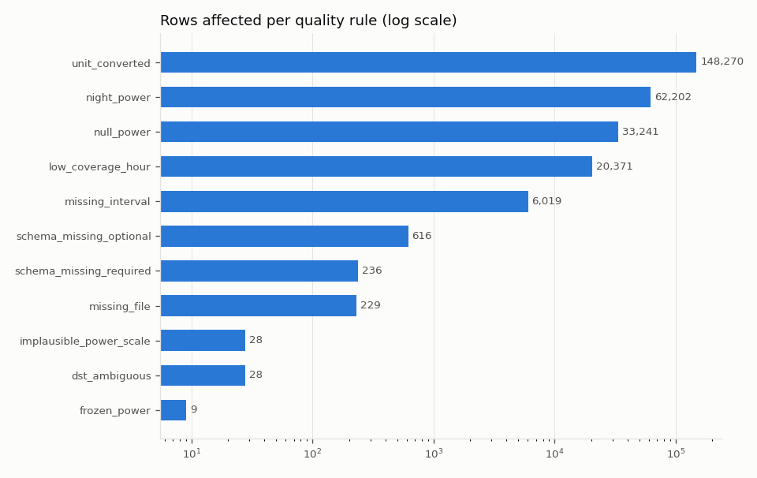

# Data quality report

Source: NREL PVDAQ (historical public monitoring data, CC BY 4.0) and the Open-Meteo historical weather archive (CC BY 4.0). This is archived open data, not a live feed.

- Run: `25714ee5fee2` (success)
- Window (local dates): 2017-01-01 to 2019-12-31
- Started / finished (UTC): 2026-10-27 12:20:33.618169 / 2026-10-27 12:20:53.018177
- Rows upserted: 157680
- Code version: local

## Systems

| System | Rated kW | DC kWp | Days | Days with energy | Energy (MWh) | Daylight hours | Daylight coverage | Median daily PR |
|---|---:|---:|---:|---:|---:|---:|---:|---:|
| 1418 Clark County NV - Desert Breeze | 42 | 43.68 | 1095 | 781 | 151.1 | 12,808 | 71.3% | 0.805 |
| 1419 Clark County NV - Hollywood Rec Center | 40 | 43.68 | 1095 | 928 | 169.1 | 12,810 | 86.8% | 0.778 |
| 1420 Clark County NV - Government Center | 30 | 35.84 | 1095 | 1095 | 177.71 | 12,802 | 99.9% | 0.918 |

Daylight coverage = share of hours with modelled GHI of at least 20 W/m² that have a trusted hourly energy value. PR (performance ratio) = AC energy / (DC kWp x plane-of-array insolation), using only hours with both values. DC kWp is module count x module rating from the PVDAQ module list, so PR is indicative, not a certified figure. Systems without an irradiance sensor show n/a.

## Rules

| Rule | Severity | Action | 1418 | 1419 | 1420 | Total |
|---|---|---|---:|---:|---:|---:|
| `missing_file` | warning | day skipped | 229 | 0 | 0 | 229 |
| `schema_missing_required` | error | day rejected | 70 | 166 | 0 | 236 |
| `schema_missing_optional` | info | field left empty | 616 | 0 | 0 | 616 |
| `unparseable_timestamp` | warning | row dropped | 0 | 0 | 0 | 0 |
| `duplicate_timestamp` | warning | later copies dropped | 0 | 0 | 0 | 0 |
| `dst_ambiguous` | warning | row dropped | 8 | 8 | 12 | 28 |
| `dst_nonexistent` | warning | row dropped | 0 | 0 | 0 | 0 |
| `missing_interval` | info | hour coverage reduced | 5,932 | 43 | 44 | 6,019 |
| `unit_converted` | info | converted to canonical unit | 23,126 | 75,063 | 50,081 | 148,270 |
| `non_numeric_value` | info | value left empty | 0 | 0 | 0 | 0 |
| `power_total_mismatch` | warning | total replaced by channel sum | 0 | 0 | 0 | 0 |
| `power_from_channels` | info | total rebuilt from channels | 0 | 0 | 0 | 0 |
| `null_power` | info | reading left empty | 33,090 | 149 | 2 | 33,241 |
| `negative_power` | warning | set to 0 | 0 | 0 | 0 | 0 |
| `power_above_capacity` | warning | value left empty | 0 | 0 | 0 | 0 |
| `implausible_power_scale` | warning | day's power left empty | 19 | 9 | 0 | 28 |
| `irradiance_out_of_range` | warning | value left empty | 0 | 0 | 0 | 0 |
| `negative_irradiance_clipped` | info | set to 0 | 0 | 0 | 0 | 0 |
| `temperature_out_of_range` | warning | value left empty | 0 | 0 | 0 | 0 |
| `frozen_irradiance` | warning | value left empty | 0 | 0 | 0 | 0 |
| `night_power` | warning | set to 0 | 14 | 595 | 61,593 | 62,202 |
| `frozen_power` | warning | value left empty | 0 | 0 | 9 | 9 |
| `low_coverage_hour` | info | hourly energy left empty | 16,329 | 4,028 | 14 | 20,371 |

Rule definitions:

- `missing_file`: PVDAQ has no file for this system and day.
- `schema_missing_required`: Timestamp or AC power column (and its per-inverter channels) absent from the file.
- `schema_missing_optional`: An optional sensor column is absent from the file.
- `unparseable_timestamp`: measured_on could not be read as a timestamp.
- `duplicate_timestamp`: The same local timestamp appears more than once.
- `dst_ambiguous`: Local time is in the repeated hour when clocks go back, so its UTC time is unknown.
- `dst_nonexistent`: Local time is in the hour skipped when clocks go forward.
- `missing_interval`: Fewer usable 15-minute readings than the local day should have.
- `unit_converted`: A sensor known to have logged in another unit for this period (e.g. °F) was converted.
- `non_numeric_value`: A sensor cell held text instead of a number.
- `power_total_mismatch`: System AC power differs from the sum of its inverter channels by more than 10% and 500 W.
- `power_from_channels`: System AC power was empty but every inverter channel had a value.
- `null_power`: AC power empty in the source.
- `negative_power`: AC power below zero (standby draw or sensor offset).
- `power_above_capacity`: AC power above 120% of the system's rated power.
- `implausible_power_scale`: Peak power under 2% of rated power on a day with at least 300 W/m² irradiance (likely wrong unit).
- `irradiance_out_of_range`: Plane-of-array irradiance below -50 or above 1,500 W/m².
- `negative_irradiance_clipped`: Small negative irradiance (-50 to 0 W/m²), a normal night-time sensor offset.
- `temperature_out_of_range`: Ambient outside -30 to 60 °C, or module outside -30 to 95 °C.
- `frozen_irradiance`: The same non-zero irradiance for 2 hours or more (stuck sensor).
- `night_power`: AC power above zero while irradiance is below 5 W/m².
- `frozen_power`: The same non-zero AC power for 2 hours or more (stuck logger).
- `low_coverage_hour`: Valid power readings cover less than 45 minutes of the hour (3 of 4 at 15-minute logging).

## Charts

